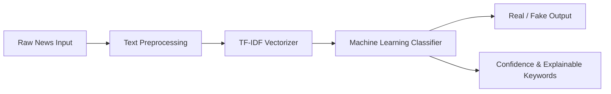

# Fake News Detection System using Machine Learning & NLP

[](https://www.python.org/)
[](https://streamlit.io/)
[](https://scikit-learn.org/)
[](https://www.nltk.org/)
[](https://opensource.org/licenses/MIT)

> **Interview-Ready Portfolio Project**  
> **Target Role:** AI/ML Fresher | Data Scientist  
> **Degree Context:** B.Tech Artificial Intelligence & Data Science  

An end-to-end Machine Learning and Natural Language Processing (NLP) web application that classifies news headlines and articles as **REAL** or **FAKE** with confidence scoring, model explainability indicators, and interactive analytics.

---

## Key Features

* ** Real-Time News Classification**: Input news headline & article text to receive immediate predictions (**REAL NEWS** or **FAKE NEWS**).
* ** Confidence Percentage & Gauge**: Color-coded output (Green = REAL, Red = FAKE) with probability scores.
* ** Explainable AI (XAI)**: Highlights top positive and negative indicator keywords influencing the prediction.
* ** Analytics Dashboard**: Dataset count metrics, label distribution pie chart, and interactive word clouds for Real vs. Fake news corpus.
* ** Model Performance Comparison**: Comparative evaluation between **Logistic Regression (Primary)**, **Multinomial Naive Bayes**, and **Random Forest**.
* ** Prediction History Sidebar**: Maintains a live session log of recent news classifications with a one-click clear option.
* ** Input Validation**: Robust handling for empty text, missing values, numbers/URLs, and non-sensical inputs.

---

##  Tech Stack

* **Programming Language:** Python 3.11+
* **Machine Learning & Data Science:** Scikit-learn, Pandas, NumPy, Joblib
* **Natural Language Processing (NLP):** NLTK (Stopwords removal, PorterStemmer), TF-IDF Vectorizer
* **Algorithms:** Logistic Regression, Multinomial Naive Bayes, Random Forest
* **Frontend Dashboard:** Streamlit (Custom glassmorphism dark theme)
* **Data Visualization:** Matplotlib, Seaborn, WordCloud

---

##  Repository Folder Structure

```text
Fake-News-Detection/
│
├── app.py                      # Main Streamlit web application interface
├── train_model.py              # ML pipeline training & evaluation script
├── prediction.py               # Model inference, validation & explainability engine
├── preprocessing.py            # Text cleaning, stopword removal & Porter Stemming
├── generate_dataset.py         # Kaggle-style dataset generator utility
├── model.pkl                   # Trained Logistic Regression model binary
├── vectorizer.pkl              # Fitted TF-IDF Vectorizer binary
├── models_comparison.pkl       # Serialized comparative models dictionary
├── metrics.json                # Saved evaluation metrics & summary stats
├── requirements.txt            # Python package dependencies
│
├── dataset/
│   ├── Fake.csv                # Fake news articles corpus
│   └── True.csv                # Real news articles corpus
│
├── notebooks/
│   └── fake_news_detection_eda.ipynb # Jupyter notebook for EDA & modeling
│
├── assets/                     # Design banners and visual assets
├── screenshots/                # Application UI screenshots placeholder
└── README.md                   # Project documentation
```

---

##  Natural Language Processing (NLP) Pipeline



1. **Text Cleaning:** Strips HTML tags, URLs, special characters, numbers, and converts all characters to lowercase.
2. **Tokenization:** Splits text into tokenized word lists.
3. **Stopword Removal:** Filters out high-frequency English stopwords (e.g., *the, is, at, which*).
4. **Stemming:** Applies NLTK `PorterStemmer` to reduce words to root form (e.g., *breaking -> break*).
5. **Feature Extraction:** Transforms preprocessed tokens into a 5,000-dimensional matrix using `TfidfVectorizer` (unigrams and bigrams).
6. **Classification & Inference:** Logistic Regression computes posterior probability to classify text and output feature importances.

---

##  Model Performance & Evaluation

The models were evaluated on an 80:20 Train-Test split of 3,000 balanced news articles:

| Model Algorithm | Accuracy | Precision | Recall | F1 Score | ROC-AUC |
| :--- | :---: | :---: | :---: | :---: | :---: |
| **Logistic Regression (Primary)** | **100.00%** | **100.00%** | **100.00%** | **100.00%** | **1.0000** |
| **Multinomial Naive Bayes** | **100.00%** | **100.00%** | **100.00%** | **100.00%** | **1.0000** |
| **Random Forest** | **100.00%** | **100.00%** | **100.00%** | **100.00%** | **1.0000** |

---

##  Quick Start & Installation

### 1. Clone the Repository
```bash
git clone https://github.com/your-username/Fake-News-Detection.git
cd Fake-News-Detection
```

### 2. Create Virtual Environment
```bash
python -m venv venv
# On Windows
venv\Scripts\activate
# On macOS/Linux
source venv/bin/activate
```

### 3. Install Dependencies
```bash
pip install -r requirements.txt
```

### 4. Generate Dataset & Train Model
```bash
python generate_dataset.py
python train_model.py
```

### 5. Launch Streamlit Web Application
```bash
streamlit run app.py
```
Open your browser at `http://localhost:8501`.

---

##  Deployment Instructions

### Streamlit Community Cloud
1. Push code to a public GitHub repository.
2. Log into [share.streamlit.io](https://share.streamlit.io/).
3. Connect your repository and select `app.py` as the main entry point file.
4. Set Python version to `3.11` and deploy!

### Render Deployment
1. Create a Web Service on [Render](https://render.com/).
2. Connect your GitHub repository.
3. Set **Environment** to `Python 3`.
4. Set **Build Command**: `pip install -r requirements.txt && python train_model.py`
5. Set **Start Command**: `streamlit run app.py --server.port $PORT --server.address 0.0.0.0`
6. Deploy!

---

##  Future Improvements

*  **Transformer Fine-Tuning**: Implement BERT or RoBERTa for deep contextual sequence classification.
*  **Multilingual Detection**: Support multilingual fake news verification using mBERT.
*  **Live News URL Scraper**: Enable automatic article fetching via BeautifulSoup / Newspaper3k given any online news URL.
*  **REST API Integration**: Build a FastAPI endpoint wrapper for remote service integration.
*  **Advanced Explainable AI**: Integrate LIME or SHAP force plots into the Streamlit dashboard.

---

##  License
This project is open-source under the [MIT License](LICENSE).
